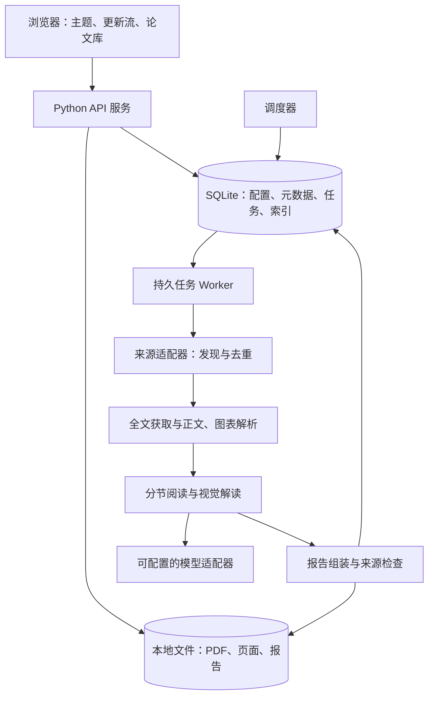

# AutoReadPaper 技术架构

状态：2026-11-03 的设计基线。首版本地应用现已实现；实际支持范围、运行方法和验证边界以 README.md 为准。本文中后续阶段与验收目标不代表均已完成。

## 1. 总体结构

采用一个模块化后端、一个浏览界面和一个独立工作进程。首版针对单机、少量主题及单个阅读 worker 设计；耗时任务不依附浏览器会话或 HTTP 请求。



图中数据库到 Worker 的箭头表示工作进程主动领取任务；SQLite 不负责推送消息。调度器可与单个 Worker 同进程运行，使用数据库事务避免重复入队。

### 部署决策与后续 Dot 兼容

用户已确定本地部署优先。首版 API、调度器、Worker、SQLite 和文件目录在同一台本地机器运行；模型通过已有适配器配置。Dot 云端运行属于后续兼容方向，其进程生命周期、网络、存储和任务触发能力需届时验证。

为便于后续接入，首版保留以下模块边界：

- 阅读流水线支持单次执行入口，完成当前批次后退出；与常驻 Worker 共用业务逻辑、幂等规则和阶段输出。
- 调度器只创建任务，阅读模块不依赖某个调度平台；后续外部触发可复用任务创建与执行接口。
- 数据根目录、模型连接及运行参数可配置，不将本机绝对路径写入报告或业务标识；任务记录通过资产 ID 和相对路径引用资料。
- 数据与资产读写集中在存储模块，首版实现 SQLite 和本地目录。未来云端 Worker 不直接并发访问或同步修改本地 SQLite 文件，需验证服务 API 或其他持久存储方案。

这些边界不代表首版已支持远程执行。Dot 适配器、云端发布及跨环境数据同步均留待后续设计与验证。

## 2. 技术选型提案

| 层次 | 首版选择 | 原因及边界 |
| --- | --- | --- |
| 后端 | Python + FastAPI，Pydantic 定义结构 | 将获取、解析、模型与 API 放在同一语言生态；响应结构显式校验 |
| 界面 | React + TypeScript + Vite | 实现信息流、筛选和图文阅读；首版不需要服务端渲染 |
| 结构化存储 | SQLite，数据库迁移 | 单机配置、论文关系与任务事务；多用户和并发扩展时再评估 PostgreSQL |
| 检索 | SQLite FTS5 + 中文分词索引 | 英文正文与中文报告分开分词；短查询补充规范化子串检索 |
| 原始文件 | 本地文件目录 + 数据库清单 | 保存源 PDF、位置化抽取、页面预览、图表与报告；便于完整备份 |
| 调度与队列 | 单 Worker + SQLite jobs 表 + 定时轮询 | 首版减少常驻组件；实现租约、重试、重启恢复与运行记录 |
| PDF 处理 | 解析器接口；PyMuPDF 作为首轮验证候选 | 提取文字坐标、页面渲染和区域裁剪；阅读顺序与图注对应须单独验证 |
| 模型 | TextModel、VisionModel 两个适配器，可共用模型 | 不绑定服务商；是否本地运行、具体模型及额度待确定 |
| 运行方式 | 本地进程；后续提供容器组合启动 | 浏览器关闭不影响后端；电脑休眠或服务退出会停止运行 |

这是一组针对首版规模的工程选择，并非性能测试结论。具体依赖版本应在实施时验证并锁定。

FTS5 支持全文检索与多种分词器，但默认分词不等于良好的中文词级检索。首版存储原文和分词后的索引文本，覆盖两字中文词等测试案例；不以 trigram 直接替代全部中文搜索。[SQLite FTS5 文档](https://www.sqlite.org/fts5.html)

PDF 文字抽取可能存在阅读顺序问题，文字块坐标与页面渲染可作为重建和核对的基础；这不等于自动完成论文版面理解。[PyMuPDF 文字处理](https://pymupdf.readthedocs.io/en/latest/recipes-text.html)、[页面渲染与裁剪](https://pymupdf.readthedocs.io/en/latest/recipes-images.html)

## 3. 模块职责

| 模块 | 输入与输出 |
| --- | --- |
| topics | 主题描述、显式查询、筛选策略、调度与配置版本 |
| sources | 标准化发现结果、来源标识、分页与检查点；首版 ArxivSource |
| catalog | 稳定论文身份、版本、多主题关联、候选合并 |
| acquisition | 固定版本全文下载、内容哈希、来源和获取状态 |
| extraction | 带页序与坐标的正文块、章节、图表候选及解析覆盖情况 |
| reading | 章节阅读、视觉解读、实验字段与证据记录 |
| reports | 报告结构校验、引用检查、报告修订与导出 |
| jobs | 原子领取、租约、心跳、重试、取消、预算预留和运行日志 |
| library | 浏览、搜索、收藏、已读状态、人工笔记与资产访问 |

来源接口暴露 discover(query, checkpoint, page_token)、resolve(identifier) 和 get_fulltext(version)。模型接口暴露文本结构化生成、图文结构化生成及用量信息。模型只能返回内容与建议，任务状态和路径由应用控制。

## 4. 从发现到阅读的流水线

### 4.1 发现、筛选与去重

首版使用 arXiv API 的字段查询和按更新时间排序，消费其标识、版本日期与全文链接。具体查询及分页遵循官方接口文档，并在来源适配器统一控制请求频率。[arXiv API 手册](https://info.arxiv.org/help/api/user-manual.html)

- 首次扫描在设定回溯范围内分页获取；后续按来源检查点与重叠窗口补检。新论文与旧论文更新分别归类。
- 页数或返回量到达本地上限时标记扫描未完成，保存续扫任务；不将截断扫描当作完整成功。
- 原始响应先缓存，标准化结果与发现记录提交成功后更新分页进度；整段扫描完成再推进完整检查点。
- 下游阅读失败不撤销已持久化的发现结果；每篇论文独立恢复。重叠抓取与周期回溯缓解索引延迟，无法保证零遗漏。
- arXiv 去版本 ID 作为来源内身份，版本号单独保存；本地文件按内容哈希识别完全重复。
- 后续加入其他源时，DOI 精确对应可关联，标题相似只产生待核对的合并建议。
- 先规则粗筛再模型判断相关性；保存命中词、理由、主题配置版本及判定版本。被排除记录可恢复。

### 4.2 全文与图表解析

1. 优先获取可公开访问的确定版本 PDF；记录 URL、获取时间、哈希、类型、大小与页数。
2. 按页提取文字块及坐标，识别章节和正文顺序；保存抽取器版本与质量信号。
3. 识别图注与图表候选区域；整页渲染作为可视证据，区域裁剪覆盖组合图与矢量内容。
4. 图号、图注、页序、区域框及匹配状态一起保存；不将 PDF 内嵌位图直接视为完整 Figure。
5. 低文本量、双栏错序或定位失败触发降级状态；扫描件 OCR 与复杂版面解析先保留接口，不默认承诺支持。
6. 抽取覆盖清单记录正文、实验、附录的可用和缺失范围；超长文分批处理，超过预算时保留部分完成状态。

### 4.3 结构化阅读

依次建立问题与方法概览、分节阅读记录、实验记录和图表解读，再合成最终报告。摘要仅用于发现、筛选和初始导航，不能代替全文证据。

每条关键记录采用统一结构：

```json
{
  "kind": "author_claim",
  "text": "作者报告的结论，或明确标注的系统分析",
  "evidence": [{"asset_id": "example-asset", "page_index": 3, "block_ids": ["b17"], "figure_label": null}],
  "verification": "source_located"
}
```

示例仅定义结构，没有论文事实。page_index 为零基 PDF 页序；界面显示时加一，并可同时显示论文印刷页码。系统分析也须关联其分析依据。

实验记录同时保存任务、数据集、划分、基线、指标方向、条件、数值、原始位置及缺失项。不同条件下的结果不自动拼成统一排名。

图表解读向视觉模型提供原图区域、图注和相邻正文。没有视觉能力时可展示原图与图注文字说明，界面明确其阅读方式；不能把图注概括标成已经理解图内细节。

### 4.4 检查与报告发布

- 校验报告结构、引用的页序和块是否存在、数字是否具备可定位依据、图文引用是否对应已保存资产。
- 可对重要结论进行二次模型检查，但不将同类模型的一致意见当作独立事实验证。
- 输出范围按能力区分为 metadata_only、abstract_only、partial_fulltext、fulltext；图像阅读方式另用 visual_mode 字段记录。
- 检查失败的草稿保留并显示待核对，自动重试次数有限；生成新修订时保留旧报告。
- 报告以结构化 JSON 为主记录，生成 Markdown 与 HTML 展示；人工笔记单独保存。

fulltext 表示预定全文范围已完成处理且未记录关键缺失，不代表结论得到独立验证。引用位置存在也不保证推理正确，仍需固定质量集人工评审。

## 5. 数据模型

| 实体 | 关键字段与约束 |
| --- | --- |
| topics / topic_revisions | 名称、描述、查询、排除条件、关注问题、时区、频率、预算、启停、配置版本 |
| source_scans | 主题配置版本、来源、查询、扫描范围、续扫 token、完整检查点、结果计数与状态 |
| papers / paper_identifiers | 规范身份、标题、作者、外部标识、首次发现时间；外部标识建立唯一约束 |
| paper_versions | paper_id、来源版本、更新时间、内容哈希；来源版本键或导入哈希唯一 |
| topic_papers | topic_id、paper_id、命中理由、判定与主题版本；多对多关联 |
| assets / extractions | 版本、相对路径、哈希、类型、页数、解析器版本与覆盖情况 |
| evidence / figures | extraction_id、页序、坐标、文字块、图号、图注及定位状态 |
| reading_runs / reports | 论文版本、阅读配置、模型、提示词／schema 版本、范围、修订号、正文与用量 |
| jobs / job_attempts | 类型、输入引用、幂等键、状态、租约、尝试次数、重试时间与错误类型 |
| budget_reservations / usage | 全局与主题日额度、预留、实际用量、未知用量、关联请求与任务 |
| user_paper_state / notes | 用户已读状态、收藏、人工笔记；笔记可引用具体论文版本或报告修订 |

逻辑论文、论文版本、抽取结果、阅读运行、报告修订相互分离。相同论文版本与阅读配置的自动任务共享结果；用户明确重读时创建新运行。

## 6. 任务与预算设计

任务状态：queued → running → succeeded；分支包括 retry_wait、blocked、failed、cancelled。blocked 必须包含原因，如模型未配置或额度暂不可用。报告阅读范围与任务成功状态分别建模。

- 调度器将到期主题转换为发现任务，幂等键包含主题、配置版本及计划时间槽；停机补检合并遗漏时间段，避免逐槽无限补跑。
- Worker 通过短数据库事务领取任务，设置 lease_until 和心跳。耗时网络与模型请求在事务外执行。
- 租约过期可重新领取；每次写回验证尝试 token，阻止已过期尝试覆盖新结果。
- 阶段输出先写临时文件，再原子替换；资产清单提交后才算完成，启动时核对遗留文件与未完成记录。
- 按指数退避和随机抖动重试暂时错误，尊重来源 Retry-After；永久错误保留人工重试入口。
- 重复调度不重复建档；外部模型调用存在“已计费但响应丢失”的窗口，记录请求与未知用量，不能承诺外部调用恰好一次。
- 执行模型步骤前在事务中预留全局与主题额度，完成后结算。共享阅读只占一次全局阅读量，费用归属与触发主题一并留存。
- 每次请求限制输入、输出和图像量；若服务商用量或价格未知，展示用量未知／费用估算，不能给出准确费用承诺。

用户暂停主题后停止新自动调度，已排队任务可取消；在途步骤结束后不再推进新步骤。手动重试和手动重读同样服从全局额度。

## 7. 文件、搜索与导出

建议的存储布局：

```text
data/
  catalog.sqlite3
  papers/<paper_uuid>/<version_uuid>/
    source.pdf
    extraction/<extraction_uuid>/document.json
    extraction/<extraction_uuid>/pages/
    extraction/<extraction_uuid>/figures/
    reports/<report_uuid>/report.json
    reports/<report_uuid>/summary.md
  exports/<export_uuid>/
    summary.md
    images/
```

标题用于显示，文件路径使用应用生成的 ID。完整档案备份须同时覆盖数据库和文件清单；备份期间协调写入，恢复后检查哈希与关联。

首版索引标题、作者、摘要、报告和笔记，搜索结果注明命中字段，展示片段。语义向量检索与跨论文问答后续再加，届时仍可复用位置化文本块和证据。

Markdown 导出使用相对图片路径，携带原文链接、论文版本、报告生成信息及阅读范围；单篇导出包可离线打开。PDF 原件是否随导出由用户单独选择。

## 8. 服务接口与运行边界

建议的 API 资源：/topics、/topics/{id}/preview、/topics/{id}/scans、/papers、/papers/{id}/versions、/reports、/imports、/jobs、/exports、/settings。

配置界面优先使用下拉列表，具体字段与预设见产品方案。增加 /configuration-options 返回来源、类别、主题模板、调度预设、语言、时区及默认值；已配置连接与可用模型按连接查询。选项包含稳定 ID、显示名称、可用状态及必要说明，数据库保存稳定 ID 与实际参数，不保存显示名称作为业务枚举。

前后端共用配置 schema 并由服务端校验来源、模型能力、时间、范围和额度。预设和自定义选项归一化为同一配置结构，星期、执行时间及时区显式保存；预设列表变化不得改写已保存配置。主题与阅读配置记录总结语言，语言参与阅读结果复用键。来源或模型不可用时保留旧选择并提示，不能静默切换。模型选项依据已配置连接返回，不硬编码未经验证的服务商模型目录，也不向选项接口暴露密钥。

触发扫描、阅读或导出采用 POST 创建任务并返回 job_id；GET 查询任务和结果，首版前端轮询即可。数据库事务维护幂等关系，客户端刷新不会重新触发模型。

首版本地服务绑定回环地址。模型密钥仅由服务端配置读取，前端只接收连接状态。全文是否发往远程模型在设置页明确展示。

外部论文和网页内容作为待分析资料，不作为系统指令。下载采用限定协议、文件大小、超时及重定向校验，拒绝访问本机和内网地址；模型输出的 HTML／Markdown 经过清理，资产路径不接受模型直接指定。这些属于实现约束，无需加入普通阅读流程。

未来对外或多人部署时，需另行引入身份与访问控制、服务端资产权限和租户隔离；当前设计不代表已经具备这些能力。

## 9. 实施顺序与退出标准

| 步骤 | 实施内容 | 退出标准 |
| --- | --- | --- |
| 1. 单篇阅读验证 | 导入确定版本 PDF，解析、分节阅读、图表解读、来源定位、导出 | 固定样例能人工核对报告；困难案例正确降级 |
| 2. 主题发现 | 主题配置、查询预览、arXiv 分页、筛选、去重与版本关系 | 重复扫描无重复档案；扫描截断和版本更新准确展示 |
| 3. 自动运行 | 持久任务、调度、租约恢复、预算与重试 | 重启恢复、断网、限流、额度耗尽等故障演练通过 |
| 4. 浏览闭环 | 更新流、主题页、论文库、详情、搜索、笔记与导出 | 用户能从主题进入报告、查原文、回看与离线保存 |
| 5. 小规模试运行 | 固定主题和质量集，定期抽查 | 报告筛选质量、事实错误、图文匹配、延迟及真实用量，修复阻断问题 |

先验证单篇阅读质量，再放大自动发现与阅读量。吞吐、延迟和费用应由实际论文、模型与运行日志测量，本阶段不提供未经测量的性能或成本数字。

参考：[FastAPI 官方文档](https://fastapi.tiangolo.com/)。更多来源接入前分别核对其最新接口、访问条件与配额；当前没有接入或测试 OpenAlex、Semantic Scholar 或会议网站。
